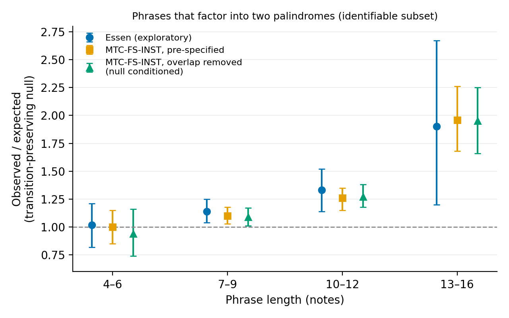
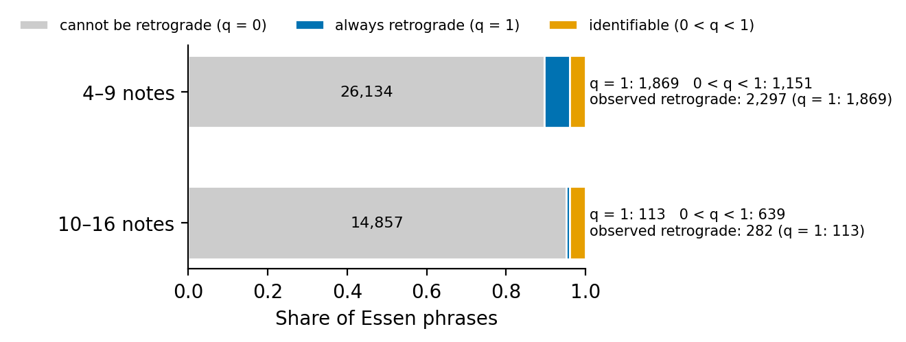
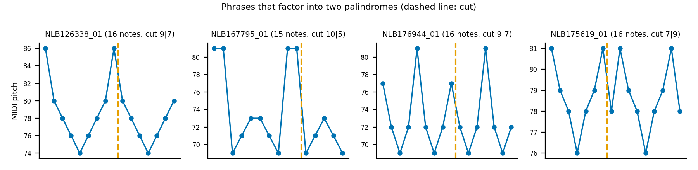
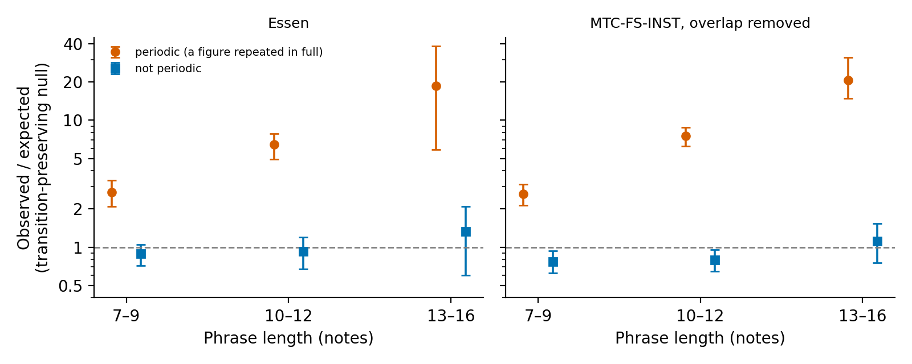

# Whole-phrase symmetry in folk melodies under a transition-preserving null

<!-- 作業題。読者: 計算音楽学の研究者。本文の数は n: の印の中を paper_numbers.py が results/*.json から埋める。数を書くときは印を付ける -->

## Abstract

Whole folk phrases are symmetric under transposition, inversion, retrograde and cyclic shift far more often than rearrangements of their own notes, about <!--n:census_oe1316-->12.7<!--/n-->-fold for Essen phrases of 13–16 notes. We ask how much of this survives a null that keeps each phrase's one-step pitch transitions and first note, the exact conditional of a first-order Markov chain, enumerated for nearly all phrases. Mirror symmetry in the narrow sense, phrases that read the same backwards, is accounted for by the transitions: a phrase whose transition counts are not reversible cannot be a palindrome, reversible counts are necessary but not sufficient, and over all phrases with reversible transitions the residual relative to the transition-preserving null is about one (7–9 notes, Essen <!--n:dec_e7_f3-->1.02 [0.95, 1.09]<!--/n-->). The retrograde class of the census is wider: on the cycle of positions it contains every product of two palindromes, and such phrases do exceed the null, increasingly with length, in Essen and, under a plan fixed in advance, in the Meertens Tune Collections. On a common set of phrases this excess splits additively by whether the whole phrase is periodic, a figure repeated in full whose cyclic form is mirror-symmetric. Under the registered definition about half of the excess at 13–16 notes lies in non-periodic phrases (periodic share <!--n:dp_share_reg1316-->49%<!--/n-->). Whether a non-periodic excess is detected thus depends on the definition; we have not separated the part played by the kinds of cut that the stricter definition excludes, a single repeated pitch or a figure moved along the scale, from the change in the identifiable set. Under a stricter definition that excludes those cuts, the periodic phrases carry the excess in the confirmation corpus (<!--n:dp_share_strict-->194% and 90%<!--/n--> of it at 10–12 and 13–16 notes; above 100% where non-periodic phrases fall short of their expectation), and no statistically clear excess was detected among the others at 13–16 notes, though a moderate one cannot be excluded. The split is exploratory. Beyond one-step transitions, much of what folk phrases add is repetition of whole figures; whether reflection-invariant figures are favoured beyond that remains open.

## 1. Introduction

Transposition, inversion and retrograde have been the basic operations of melodic analysis since the twelve-tone technique, and they organise much of transformational theory. Whether melodies actually use them more than chance, however, has only recently been counted on large corpora. González-Espinoza [1] read melodic lines through the orbits and stabilisers of short windows under the group generated by transposition, inversion, retrograde and cyclic shift, and complemented this with a census of whole phrases and themes. In the census a phrase is symmetric when its stabiliser under D12 × DL is non-trivial. Folk phrases and instrumental themes were symmetric only in 2–10% of cases, but 1.6 to 5 times more often than rearrangements of their own notes, and about 13 times more often among Essen phrases of 13 to 16 notes [1].

Rearranging a phrase's notes breaks its steps. Folk phrases move mostly by step and often return to where they started, and such motion produces short mirror figures by itself. González-Espinoza notes this for short windows, where lines that keep only their one-step transitions reproduce most of the excess of mirror figures, and leaves the corresponding test for whole phrases open: long palindromes "need an exact order and should survive a null that keeps each phrase's steps", a test left for future work [1].

This paper carries out that test. For each phrase we take as the null the uniform distribution over all distinct pitch sequences that have the same multiset of one-step transitions (ordered pairs of consecutive pitches) and the same first note. The null is the exact conditional of a first-order Markov chain given its sufficient statistics, and is the musical analogue of the doublet-preserving shuffles used for biological sequences [2, 3]. Because most phrases are short, the null can be enumerated exactly for all but a handful of them; for the rest we sample it uniformly.

Three findings follow.

First, under this null the excess of mirror symmetry (the retrograde and retrograde-inversion classes of [1]) nearly vanishes, while the excess of translational and multiple symmetry remains. But the null also fixes, for more than <!--n:fixed_floor-->95%<!--/n--> of phrases, whether a phrase can be mirror-symmetric at all. A phrase that reads the same backwards must have a symmetric transition count (as many a→b as b→a steps) and equal first and last notes, and only <!--n:rev_essen_range-->2–5.5%<!--/n--> of Essen phrases, depending on length, satisfy this. The vanishing of the mirror excess is therefore largely a statement about which phrases the null can distinguish, and we report results on the identifiable subset separately.

Second, the excess of mirror symmetry measured against note rearrangements decomposes exactly into three factors: more phrases with reversible transition counts than chance, a higher chance that a reversible phrase's own transitions form a palindrome, and a residual relative to the transition-preserving null. For phrases of 7–9 notes, where palindromes are common enough to estimate all three, the residual is <!--n:dec_e7_f3-->1.02 [0.95, 1.09]<!--/n--> in Essen and <!--n:dec_a7_f3-->0.84 [0.70, 0.93]<!--/n--> in MTC-ANN, so in neither corpus do palindromes exceed what their transitions predict.

Third, the retrograde class of [1] allows any reflection axis of the position cycle. We show that a cyclic word is invariant under such a reflection exactly when it is a product of two palindromes, and most long "mirror" phrases are of this two-part kind rather than ordinary palindromes. Phrases that factor into two non-trivial palindromes do exceed the transition-preserving null, increasingly with length. We found this in Essen, fixed an analysis plan, and confirmed it on the Meertens Tune Collections, including after removing every phrase shared with the corpora already used. Much of the excess, however, is a repeat of the whole phrase seen from another side. When a phrase is periodic, the same figure stated two or more times in full, and that figure read as a cycle is mirror-symmetric, the whole phrase is a product of two palindromes; such phrases exceed the transition-preserving null about <!--n:per_1316-->21<!--/n-->-fold at 13–16 notes (stricter definition, on the phrases identifiable for that event), about twice the excess of periodic phrases in general (Section 4.7; Table 1, translation class). Splitting the two-palindrome excess on one common set of phrases, under the stricter definition the periodic phrases carry it in the confirmation corpus; under the registered definition about half of the excess at 13–16 notes is non-periodic, so whether a non-periodic excess is detected depends on the definition; we have not separated the role of the cuts the stricter definition excludes from the change in the identifiable set (Table 2).

## 2. Data

All melodies were taken from MTCFeatures version 1.1 [4], which distributes the Essen Folksong Collection [5] and the Meertens Tune Collections [6] as sequences of per-note features with phrase boundaries. We used the MIDI pitch and the phrase index of each note, and for one sensitivity analysis the diatonic pitch. A phrase is a maximal run of notes with the same phrase index; following [1] we keep phrases of 4 to 16 notes. Rests, durations and metre are not used.

- **Essen** (essen_sequences-1.1): <!--n:dc_essen_ph-->44,765<!--/n--> phrases, the same number as in [1]. Used for exploration.
- **MTC-ANN 2.0.1**: <!--n:dc_ann_tunes-->360<!--/n--> Dutch folk songs, <!--n:dc_mtc_ann_ph-->1,890<!--/n--> phrases, also as in [1]. Used for exploration.
- **MTC-FS-INST 2.0**: <!--n:dc_fs_tunes-->18,109<!--/n--> tunes (<!--n:dc_fs_voc-->9,195<!--/n--> vocal, <!--n:dc_fs_ins-->8,914<!--/n--> instrumental), <!--n:dc_fsinst_ph-->93,938<!--/n--> phrases. Used only for the pre-specified confirmation (Section 4.5). All <!--n:dc_ann_in_fs-->360<!--/n--> MTC-ANN songs turned out to be included in it; we therefore also built a disjoint version by removing those songs and every phrase whose interval sequence (transposition-invariant) occurs in Essen or MTC-ANN. This removed <!--n:dc_removed-->19,301 phrases (1,890 with the MTC-ANN songs and 17,411 by the matching rule)<!--/n-->, leaving <!--n:dc_fsinst_disjoint_ph-->74,637<!--/n--> phrases in <!--n:dc_dj_tunes-->17,749<!--/n--> tunes.

The files were downloaded from Zenodo record 3551003 on 2 November 2026; their SHA-256 prefixes are <!--n:dc_sha-->696141b86a226ded (Essen), 6316ab402994ba59 (MTC-ANN) and 5b7d2f1c277cfac6 (MTC-FS-INST)<!--/n-->. The data are not redistributed.

Identical phrases inflate counts of symmetric phrases, because songs repeat lines and collections contain variants of the same tune. Unless stated otherwise we therefore keep one phrase per distinct pitch sequence within a song and, where marked, one phrase per distinct interval sequence across the whole corpus. Observed and expected counts are always computed on the same retained phrases.

## 3. Methods

### 3.1 Symmetry classes

We follow the census of [1]. A phrase of L notes is read as a cyclic word x of pitch classes. The position operations are the cyclic shifts and the reflections ρ_s(i) = s − i (mod L) of the position cycle, for any axis s; the pitch operations are transposition and inversion. A phrase belongs to the retrograde class if x_i = x_{ρ_s(i)} + k for some reflection and transposition k; to the retrograde-inversion (RI) class if x_i + x_{ρ_s(i)} is constant for some reflection; to the translation class if it is fixed by a non-trivial cyclic shift with some transposition; and to the multiple class if it satisfies more than one of these. We verified the implementation on hand-checkable cases (an ordinary palindrome, a scale, a period-two oscillation, an asymmetric phrase), and it reproduces the census of [1] (Section 4.1).

We also use two narrower events. An ordinary palindrome reads the same backwards in pitch (or pitch class). A two-palindrome phrase is not an ordinary palindrome but can be cut into two palindromes of at least two notes each; the phrase is counted once whatever the number of such cuts. Appendix A shows that a cyclic word is invariant under some reflection without transposition exactly when it is a product of two (possibly empty or one-letter) palindromes, so two-palindrome phrases form the bulk of the retrograde class at longer lengths.

### 3.2 Transition-preserving null

For a phrase p = (p_1, …, p_L) of MIDI pitches let T(p) be the multiset of ordered pairs (p_i, p_{i+1}). The null set N(p) is the set of distinct pitch sequences y of length L with y_1 = p_1 and T(y) = T(p); the last note is then fixed as well. Each sequence in N(p) is an Eulerian trail through the multigraph whose edges are the transitions of p, but trails that differ only in the order of parallel edges give the same sequence and are counted once. The null distribution is uniform on N(p).

When |N(p)| ≤ <!--n:cap-->5,000<!--/n--> we enumerate N(p) by depth-first search; this covers <!--n:over_cap-->all but two Essen phrases and four MTC-FS-INST phrases<!--/n--> (and every MTC-ANN phrase). Otherwise we draw uniform samples with the method of Kandel et al. [3]: the last exit edge of each vertex is chosen as a uniform random spanning arborescence directed to the final vertex (we use Wilson's loop-erased random walk), the remaining exit edges are shuffled, and the trail is read off. We checked uniformity against enumeration on <!--n:au_desc-->200 phrases of 13–16 notes with 54 to 1,680 distinct sequences<!--/n--> (the first such phrases in Essen with 50 to 2,000 sequences, each phrase sampled 50 times per sequence): every enumerated sequence was drawn, no other sequence was, and the χ² p-values were consistent with uniformity (<!--n:au_res-->11 of 200 below 0.05; Kolmogorov–Smirnov test against the uniform distribution p = 0.59<!--/n-->).

We also report the two nulls of [1], uniform rearrangements of a phrase's notes and of its intervals from the same first note.

### 3.3 Expected counts and the identifiable subset

For an event A and phrase i, q_i is the probability of A under the null: the fraction of N(p_i) on which A holds. For a set of phrases, O is the number with A and E = Σ q_i, and we report O/E. Phrases with q_i = 0 or 1 contribute equally to O and E, and they are the majority (Section 4.3); we therefore also report O/E on the identifiable subset 0 < q_i < 1.

Intervals are 95% percentile intervals from 1,000 bootstrap resamples of songs, recomputing O and E on the same resampled phrases. To describe dependence on length we fit, on the identifiable subset, the logistic model logit P(A_i) = logit(q_i) + β_0 + β_1 (L_i − 10), whose offset makes β_0 = β_1 = 0 the null; β_1 is reported with a 300-resample song bootstrap interval.

### 3.4 Decomposition of the excess over note rearrangements

For ordinary palindromes in pitch, let r_i indicate that phrase i has a reversible transition count (as many a→b as b→a pairs, and equal first and last notes), a_i and b_i the probabilities that a note rearrangement of phrase i is reversible and is a palindrome (400 random rearrangements each), and q_i the palindrome probability under the transition-preserving null. A palindrome must be reversible, so q_i = 0 when r_i = 0, and

O / Σb_i = [Σr_i / Σa_i] × [(Σ_{r_i=1} q_i / Σr_i) / (Σb_i / Σa_i)] × [O / Σ_{r_i=1} q_i].

The three factors measure how often phrases are reversible relative to note rearrangements, how much more often a reversible phrase's own transitions form a palindrome than a reversible rearrangement does, and the residual relative to the transition-preserving null.

## 4. Results

### 4.1 Reproducing the census

With note rearrangements as the null, Essen phrases of 13–16 notes are symmetric <!--n:census_oe1316-->12.7<!--/n--> times more often than expected, against 12.9 in [1]. Overall <!--n:census_sym_share-->9.8%<!--/n--> of Essen phrases are symmetric (10% in [1]); the retrograde class accounts for <!--n:pc_retro_essen-->59%<!--/n--> of symmetric Essen phrases and <!--n:pc_retro_ann-->69%<!--/n--> of symmetric MTC-ANN phrases, the "59 to 69%" reported as mirroring in [1].

### 4.2 Symmetry classes under the transition-preserving null

Table 1 compares the two nulls on Essen. Against note rearrangements every class is in excess and the excess grows with length; against the transition-preserving null the mirror classes are at or below expectation (retrograde <!--n:cl_retro-->0.99 and 1.08<!--/n-->, RI <!--n:cl_ri-->0.98 and 0.81<!--/n--> for 4–9 and 10–16 notes), while translation (<!--n:cl_tr-->1.20 and 4.05<!--/n-->) and multiple symmetry (<!--n:cl_mu-->1.27 and 2.31<!--/n-->) remain in excess. Expected values here are exact for <!--n:cl_exact_n-->44,763<!--/n--> of <!--n:dc_essen_ph-->44,765<!--/n--> phrases. Rearranging intervals, the second null of [1], does not remove the mirror excess (<!--n:iv_mirror1316-->7.29<!--/n--> for phrases of 13–16 notes that are fixed by a reflection but by no cyclic shift): what matters is the order of the steps, not which steps are used. Repetition need not be exact or cyclic to exceed this null. Taking as the event that some stretch of at least k pitches occurs twice within the phrase, on the identifiable subset after deduplication, the observed counts exceed the expected ones for k = 3 and 4 in every length band of 7–9, 10–12 and 13–16 notes, and from 10 notes the excess grows with k; the one interval that includes one is for five-note repeats in 7–9-note phrases of MTC-FS-INST, where few phrases can hold such a repeat (Essen, <!--n:rep_essen-->k = 3: 1.28, 1.22 and 1.18; k = 4: 1.53, 1.54 and 1.40; k = 5: 1.50, 2.04 and 1.68<!--/n-->; disjoint MTC-FS-INST, <!--n:rep_fs-->k = 3: 1.20, 1.23 and 1.24; k = 4: 1.48, 1.62 and 1.58; k = 5: 1.16, 2.15 and 2.13<!--/n-->). Counting patterns that recur more often than a first-order Markov model predicts is the basis of statistical pattern discovery in music [11]; that approach scores specific patterns across a corpus against a model fitted to the corpus, whereas here the event is the recurrence of any figure within a single phrase, judged against the exact conditional null of that phrase.

<!--table:t1-->
| Class | 4–9, notes null | 4–9, transitions null | 10–16, notes null | 10–16, transitions null |
|---|---|---|---|---|
| retrograde | 1.30 | 0.99 | 2.88 | 1.08 |
| RI | 1.49 | 0.98 | 2.21 | 0.81 |
| translation | 6.83 | 1.20 | 110.5 | 4.05 |
| multiple | 1.88 | 1.27 | 9.01 | 2.31 |
<!--/table-->

Table 1. Observed/expected counts of symmetric Essen phrases, no deduplication. Notes null: 200 random rearrangements per phrase.

### 4.3 Most phrases are not identifiable

The transition-preserving null decides the mirror class of most phrases. Of <!--n:ident49_total-->29,154<!--/n--> Essen phrases of 4–9 notes, <!--n:ident49_q0-->26,134<!--/n--> cannot be retrograde under any rearrangement that keeps their transitions (q = 0) and <!--n:ident49_q1-->1,869<!--/n--> are retrograde under every such rearrangement (q = 1); only <!--n:ident49_mid-->1,151<!--/n--> can go either way (Figure 2). The phrases with q = 1 are <!--n:ident49_q1_share-->81%<!--/n--> of the <!--n:ident49_retro_obs-->2,297<!--/n--> observed retrograde phrases of that length. The ratio O/E ≈ 1 in Table 1 is therefore mostly a statement that the null reproduces these phrases by construction.

The reason is simple for ordinary palindromes. A sequence that reads the same backwards has, for every pair of pitches, as many steps a→b as b→a, and equal first and last notes. Only <!--n:rev_essen_share-->5.5%, 5.1%, 2.9% and 2.2%<!--/n--> of Essen phrases of 4–6, 7–9, 10–12 and 13–16 notes (deduplicated within songs) have such reversible transitions; for all others q = 0, and no phrase without reversible transitions has q > 0. Most folk phrases are, at the level of their step counts, irreversible in time, the phrase-level counterpart of the irreversibility of whole pieces reported by González-Espinoza et al. [7].

On the identifiable subset, after removing repeated phrases within and across songs, we detected no statistically clear excess of retrograde phrases at any length (O/E with song-level bootstrap intervals <!--n:ri_dg_oe-->0.68 [0.44, 0.96], 1.06 [0.94, 1.18], 1.11 [0.94, 1.30] and 1.26 [0.78, 1.79]<!--/n--> for the four length bands); at 4–6 notes they are fewer than their transitions predict, on <!--n:ri_n46-->67<!--/n--> identifiable phrases.

### 4.4 Where the excess over note rearrangements comes from

For ordinary palindromes in pitch, the identity of Section 3.4 splits the excess over note rearrangements into three factors (Essen, phrases deduplicated within songs). For 7–9 notes, where <!--n:dec_n7-->200<!--/n--> palindromes allow interval estimates, <!--n:dec_e7-->O/E = 2.17 [1.87, 2.52] is the product of 1.36 [1.27, 1.45] for reversibility, 1.57 [1.39, 1.77] for the ease with which a reversible phrase's transitions form a palindrome, and 1.02 [0.95, 1.09] for the residual<!--/n-->. MTC-ANN gives <!--n:dec_a7-->6.94 = 2.42 × 3.41 × 0.84<!--/n--> for the same lengths (<!--n:dec_a7_n-->15<!--/n--> palindromes). Its residual, <!--n:dec_a7_f3-->0.84 [0.70, 0.93]<!--/n-->, is below one, and stays below one when the <!--n:ann_families-->26<!--/n--> tune families rather than the songs are resampled (<!--n:dec_a7_f3_fam-->[0.00, 0.98]<!--/n-->); with <!--n:dec_a7_n-->15<!--/n--> palindromes we do not interpret the shortfall. For 4–6 notes a small residual remains, <!--n:dec_e4_f3-->1.09 [1.04, 1.15]<!--/n-->. One candidate is the placement of a single departure from a repeated note in the middle of the phrase: of <!--n:mj_n-->20<!--/n--> five-note phrases whose transitions allow three arrangements, <!--n:mj_mid-->11<!--/n--> put the departure in the middle where <!--n:mj_exp-->6.7<!--/n--> are expected, too few to conclude. For 10 notes and more there are too few ordinary palindromes (<!--n:dec_n_long-->26 and 7<!--/n--> in Essen) for the decomposition to be informative.

The decomposition also orders the collections. In Essen children's songs <!--n:rg_kindr-->9.5% of phrases of 7–16 notes are reversible and 2.26% are palindromes<!--/n-->, against <!--n:rg_deut-->4.0% and 0.82%<!--/n--> in the German songs as a whole and <!--n:rg_shanx-->1.1% and 0.11%<!--/n--> in the Shanxi songs; the ratio of palindromes to reversible phrases lies between <!--n:rg_ratio_de-->0.18 and 0.24<!--/n--> in the four German-language collections (German, children's, Austrian and Swiss songs) and is <!--n:rg_ratio_cn-->0.10 in both the Han and the Shanxi collections<!--/n-->. These figures are not adjusted for phrase length, range or the share of repeated notes.

### 4.5 Phrases made of two palindromes

Among Essen phrases of 10–16 notes in the retrograde class, <!--n:ta_two-->191<!--/n--> of <!--n:ta_n-->282<!--/n--> factor into two non-trivial palindromes and only <!--n:ta_pal-->16<!--/n--> are ordinary palindromes. This led us to examine two-palindrome phrases as an event of their own. The analysis was chosen after seeing these results and is exploratory for Essen. On the identifiable subset, with repeated phrases removed within and across songs, their O/E rises with length: <!--n:tp_essen_oe-->1.02, 1.14, 1.33 and 1.90<!--/n--> for the four length bands, with β_1 = <!--n:tp_essen_beta-->0.077 [0.011, 0.143]<!--/n--> (Figure 1).

Before opening MTC-FS-INST we fixed the analysis: the same code and arguments, with hypotheses H1, β_1 > 0 (lower bootstrap limit above zero), and H2, an excess for 10–16 notes (point estimates above one in both bands and a lower limit above one in at least one). The plan was committed to a private repository at 23:26 on 2 November 2026; it is not a public, time-stamped registration. On MTC-FS-INST, β_1 = <!--n:tp_fs_beta-->0.153 [0.118, 0.187]<!--/n--> and O/E = <!--n:tp_fs_1012-->1.26 [1.15, 1.35]<!--/n--> and <!--n:tp_fs_1316-->1.96 [1.68, 2.26]<!--/n--> for 10–12 and 13–16 notes, so both hypotheses were supported. MTC-FS-INST, however, contains all <!--n:dc_ann_in_fs-->360<!--/n--> MTC-ANN songs and shares many phrases with Essen. On the disjoint version (Section 2), conditioning the null on the same exclusion (<!--n:dj_dropped-->0.10%<!--/n--> of null sequences removed), β_1 = <!--n:tp_dj_beta-->0.169 [0.130, 0.217]<!--/n--> and O/E = <!--n:tp_dj_1012-->1.27 [1.18, 1.38]<!--/n--> and <!--n:tp_dj_1316-->1.95 [1.66, 2.25]<!--/n-->. Variants of the same tune that differ in a single note are not caught by this exclusion. Resampling tune families of MTC-FS-INST (songs without a family label count as their own cluster; <!--n:fam_n-->1,558<!--/n--> clusters against <!--n:song_n-->1,785<!--/n--> songs among the identifiable phrases) instead of songs leaves the intervals almost unchanged (<!--n:fam_beta-->β_1 = 0.169 [0.130, 0.212]; with the stricter definition, 0.200 [0.139, 0.254]<!--/n-->), and <!--n:fam_conc-->the 65 observed phrases of 13–16 notes under the stricter definition come from 60 family clusters, at most 3 from any one<!--/n-->. What these confirmed excesses consist of is taken up in Section 4.7: they come from phrases that repeat a whole figure.

### 4.6 Sensitivity to the definition

Two kinds of two-palindrome phrase are of little musical interest: those in which one part is a single repeated pitch, and those whose two equal-length parts are the same figure moved along the scale. Excluding both, from observed and null sequences alike, removes the excess at 7–9 notes (<!--n:cl7-->Essen 1.04 [0.89, 1.23], MTC-FS-INST 0.95 [0.82, 1.07]<!--/n-->) but not at 10 notes and more (<!--n:cl10-->Essen 1.24 [1.00, 1.47] and 1.92 [1.04, 2.81]; MTC-FS-INST 1.18 [1.02, 1.33] and 2.12 [1.66, 2.59]; disjoint MTC-FS-INST 1.20 and 2.09<!--/n-->), and the length trend remains in all three (<!--n:cl_beta-->β_1 = 0.113 [0.036, 0.188], 0.188 [0.132, 0.241] and 0.200 [0.133, 0.250]<!--/n-->). An oscillation between two pitches of odd length (x y x y x) is a palindrome by construction; requiring in addition at least three distinct pitch classes in each part, which is possible only from 10 notes because a palindrome of n notes has at most ⌈n/2⌉ distinct pitches, makes the excess larger rather than smaller (<!--n:min3-->Essen 2.19 [1.19, 3.32] and 2.56 [0.94, 4.68]; disjoint MTC-FS-INST 2.07 [1.48, 2.69] and 3.23 [2.22, 4.37] for 10–12 and 13–16 notes, from 33 and 25 observed phrases<!--/n-->), in vocal and instrumental tunes alike (the full MTC-FS-INST, not the disjoint version, so the vocal half still contains the 360 MTC-ANN songs; <!--n:min3_vi-->vocal 2.38 [1.28, 3.60] and 2.54 [1.15, 3.86], instrumental 1.88 [1.22, 2.56] and 3.60 [2.44, 5.00]<!--/n-->); a clear excess was detected in periodic phrases and none in the others (Section 4.7; disjoint MTC-FS-INST, <!--n:min3_per-->periodic 8.41 [6.84, 10.02] and 22.65 [16.74, 32.89], not periodic 0.76 [0.31, 1.22] and 1.14 [0.50, 1.99]<!--/n-->). The excess also appears in both the vocal and the instrumental halves of the full MTC-FS-INST (<!--n:tp_vi_beta-->β_1 = 0.167 [0.109, 0.214] and 0.123 [0.065, 0.178]<!--/n-->). Within Essen the regional picture depends on the definition (<!--n:region-->with the registered definition β_1 = 0.113 [0.013, 0.206] in the German-language and 0.084 [-0.011, 0.160] in the Chinese collections; with the stricter definition 0.073 [-0.044, 0.190] and 0.159 [0.045, 0.289]<!--/n-->): the length trend in the German-language collections rests largely on the two kinds excluded above, whereas in the Chinese collections it appears only once they are excluded. These sensitivity analyses were added after the confirmation and are exploratory.

Figure 3 shows four phrases from the disjoint MTC-FS-INST that pass the stricter definition, the first four in file order with 13–16 notes and at least four notes on each side of the cut. Three of them are an eight-note figure stated twice, with the palindromic cut falling inside the second statement, so that the phrase looks like a figure followed by a shorter or longer one that goes out and returns in the same way; the fourth repeats its opening eight-note figure with one repeated note left out. Section 4.7 shows that this is typical.

### 4.7 Nested and periodic phrases

Looking at the phrases behind this excess showed many in which one part is a contiguous stretch of the other, as in D E F♯ G A G F♯ E D | E F♯ G A G F♯ E. We call such a cut nested (the shorter part occurs, with the same pitch classes, inside the longer one) and split the stricter definition by it. Nested two-palindrome phrases are strongly in excess (<!--n:nest_only-->Essen 2.59 [1.96, 3.17], 3.06 [2.00, 4.42] and 4.01 [1.14, 9.00]; disjoint MTC-FS-INST 2.21 [1.76, 2.66], 4.82 [3.89, 5.79] and 9.72 [6.58, 13.75] for 7–9, 10–12 and 13–16 notes<!--/n-->), while the rest are not (10–12 and 13–16 notes: <!--n:nest_no-->Essen 1.04 [0.79, 1.31] and 1.52 [0.71, 2.38], β_1 = 0.067 [-0.016, 0.154]; disjoint MTC-FS-INST 0.83 [0.67, 0.98] and 1.12 [0.72, 1.55], β_1 = 0.066 [-0.011, 0.138]<!--/n-->). Requiring three pitch classes per part gives the same split (disjoint MTC-FS-INST, <!--n:nest_min3-->0.88 [0.46, 1.36] and 1.02 [0.43, 1.80] without nesting, 9.39 [7.85, 10.79] and 20.12 [15.10, 27.30] with it<!--/n-->). Under the registered definition without nested cuts some excess remains at 13–16 notes (disjoint MTC-FS-INST, <!--n:nest_orig-->13–16 notes O/E = 1.61 [1.32, 1.90], β_1 = 0.098 [0.054, 0.145]<!--/n-->), and it is removed by excluding the two kinds above, a repeated single pitch and a figure moved along the scale, which are themselves forms of repetition. If the nested excess comes from repetition, a null that also keeps repeated three-note groups should absorb part of it. Each conditional null below also changes which phrases are identifiable, so its ratios are computed on a different set of phrases from the unconditioned ones and describe the identifiable subset under that condition; only the paired comparison at the end of this paragraph holds the phrases fixed. Conditioning instead on the multiset of consecutive note triples and the first two notes gives, on the identifiable subset under that condition, a smaller nested ratio whose length-trend interval includes zero (disjoint MTC-FS-INST, <!--n:order2-->nested phrases 2.29 [1.83, 2.89] and 2.59 [1.71, 4.03] for 10–12 and 13–16 notes, β_1 = 0.066 [-0.216, 0.406]<!--/n-->), though not to one, as expected if many repeated figures are longer than three notes. Going one order further (four-note groups) leaves almost no identifiable phrases (nested: <!--n:order3-->1.91 [1.24, 2.50] and 2.09 [1.68, 2.67] from only 8 and 16 identifiable phrases<!--/n-->), so this route cannot follow longer repeats. Metre is another candidate: in a regular metre, ornamental notes around a held pitch tend to fall on positions of equal metrical weight, which could make two-part shapes symmetric. Conditioning instead on which pitch falls on which metrical strength (MTC beatstrength) gives, on the phrases identifiable under that condition, a nested ratio smaller than the unconditioned 4.82 and 9.72 but above one in MTC-FS-INST (<!--n:beat-->disjoint MTC-FS-INST, nested 1.93 [1.37, 2.60] and 3.03 [2.10, 4.62] for 10–12 and 13–16 notes, not nested 0.90 and 0.80; Essen, nested 3.02 [1.73, 4.85] and 1.52 [0.41, 2.89] from 12 and 17 identifiable phrases<!--/n-->); in Essen the 13–16-note value rests on too few phrases to tell. The beat-strength condition used here (the multiset of pitch and metrical-strength pairs) therefore does not account for the excess; other representations of metre were not tried. A different way to hold repetition fixed is to keep only those transition-preserving rearrangements whose longest repeated stretch (a contiguous run of pitches occurring at least twice) has the same length as in the phrase itself. On the identifiable subset under this condition the nested ratio is about a third of the unconditioned one but stays above one (disjoint MTC-FS-INST, <!--n:lrcond-->nested 1.87 [1.52, 2.28] and 3.08 [2.05, 4.65] for 10–12 and 13–16 notes, against 4.82 and 9.72 without the condition; not nested 0.93 and 0.99<!--/n-->). Requiring in addition that the longest repeat sits at the same positions as in the phrase leaves few identifiable phrases (<!--n:posrep-->nested 0.77 [0.36, 1.20] and 1.73 [1.08, 2.65] from 15 and 27 identifiable phrases; not nested 1.53 [1.05, 2.02] at 13–16 notes<!--/n-->). These phrases are a selected set: on exactly the same phrases the length condition alone leaves much larger excesses, and the position condition removes half or more of them, for nested and other cuts alike (<!--n:paired-->nested, 14 and 26 phrases: 2.61 [1.24, 4.44] and 3.58 [2.33, 5.66] with the length condition, 0.82 [0.42, 1.29] and 1.78 [1.07, 2.74] with the position condition; not nested, 88 and 49 phrases: 1.84 [1.37, 2.30] and 3.25 [2.09, 4.73], against 1.05 [0.78, 1.31] and 1.61 [1.10, 2.19]<!--/n-->). Fixing where the longest repeat recurs, together with the pitches it carries there (the condition fixes both, and we have not separated the two), thus accounts for most of what the length of the repeat leaves, and with it for most of the difference between nested and other cuts; the excess remaining at 13–16 notes rests on few phrases. We made this paired comparison after seeing the unpaired position-condition results, so it is exploratory as well. The nested split was defined after the confirmation and is exploratory.

Counting the nested phrases shows what they are. The example above is the eight-note figure D E F♯ G A G F♯ E stated twice; a palindromic cut one note into the second statement makes it look like a figure and a shortened echo. Of the nested two-palindrome phrases observed in the disjoint MTC-FS-INST, <!--n:aa_share-->51 of 57 and 29 of 34<!--/n--> at 10–12 and 13–16 notes have identical first and second halves, and most of the rest are periodic with a shorter period (F♯ G F♯ G …) or repeat at the octave. We therefore split all two-palindrome phrases, nested or not, by whether the whole phrase is periodic, that is, the same pitch-class figure repeated in full with a period dividing its length. A periodic phrase whose figure is mirror-symmetric as a cycle is itself a product of two palindromes. Periodic two-palindrome phrases are far in excess (Figure 4; <!--n:per-->disjoint MTC-FS-INST 7.54 [6.27, 8.80] and 20.61 [14.90, 31.32], Essen 6.42 [4.94, 7.88] and 18.59 [5.86, 38.57] for 10–12 and 13–16 notes<!--/n-->), about twice as much as periodic phrases in general, which are themselves in excess (Table 1, translation class; <!--n:per_all-->periodic phrases as such: disjoint MTC-FS-INST 4.94 [4.57, 5.32] and 9.68 [8.52, 11.16], Essen 4.40 [3.93, 4.96] and 9.47 [7.67, 11.84]<!--/n-->). Two-palindrome phrases that are not periodic show no statistically clear length trend, and computed on their own identifiable subset we detected no clear excess among them (<!--n:noper-->disjoint MTC-FS-INST 0.80 [0.65, 0.96] and 1.12 [0.75, 1.54], β_1 = 0.059 [-0.012, 0.135]; Essen 0.92 [0.67, 1.21] and 1.33 [0.60, 2.10], β_1 = 0.032 [-0.060, 0.125]<!--/n-->). Ratios computed on separately chosen subsets do not add up to the total excess, because each event has its own identifiable phrases. We therefore also split the excess on one common set, the phrases whose probability of being a two-palindrome phrase lies strictly between zero and one, counting for each phrase the observed and expected number of periodic and of non-periodic two-palindrome arrangements; observed and expected counts of the two parts then add exactly to those of the whole (Table 2, song-level bootstrap intervals for O − E). Under the stricter definition in the confirmation corpus the periodic phrases carry the excess (<!--n:dp_share_strict-->194% and 90%<!--/n--> of it at 10–12 and 13–16 notes), and the non-periodic part at 13–16 notes is <!--n:dp_np_strict_1316-->+3.1 [−6.8, +14.3]<!--/n-->: no statistically clear excess, though an excess of a few phrases is not excluded; in Essen it is <!--n:dp_np_essen_strict-->−3.7 [−14.9, +9.0] and +2.5 [−2.7, +8.5]<!--/n--> at 10–12 and 13–16 notes (periodic share at 13–16 notes <!--n:dp_share_essen_strict1316-->66%<!--/n-->). Under the registered definition the non-periodic part in the confirmation corpus is <!--n:dp_np_reg-->−5.2 [−28.8, +19.5] and +32.1 [+16.7, +48.4]<!--/n--> at 10–12 and 13–16 notes, so at 13–16 notes about half of the excess (periodic share <!--n:dp_share_reg1316-->49%<!--/n-->) lies outside periodic phrases. The stricter definition differs only by excluding cuts into a single repeated pitch and into a figure moved along the scale, but the two definitions also have different identifiable subsets, so the detection of a non-periodic excess depends on the definition and we have not separated the contribution of the excluded kinds of cut from that of the change in subset. Requiring three pitch classes per part gives a split close to the stricter definition in MTC-FS-INST. Under the stricter definition at 7–12 notes the non-periodic phrases are fewer than their transitions predict in MTC-FS-INST (<!--n:dp_np_clean_fs-->−24.7 [−40.6, −7.9] and −23.1 [−41.7, −7.2]<!--/n--> for 7–9 and 10–12 notes), so there the total excess is a periodic excess partly offset by a non-periodic deficit; we have not examined where the deficit comes from. The conditional nulls above all constrain how a phrase repeats, which is why each of them shrinks the nested excess; the periodic split indicates that much of what they were absorbing is a repeat of the whole phrase. This split was defined after all the analyses above and is exploratory.

**Table 2.** The two-palindrome excess split on one common set of identifiable phrases by whether the whole phrase is periodic (deduplicated within and across songs; O − E in phrases with song-level bootstrap 95% intervals). Periodic share is the periodic part divided by the whole, shown only where the whole excess has a lower limit above zero; it can exceed 100% when the non-periodic part is negative.

<!--table:dp-->
| Corpus, definition | Notes | Phrases | Excess O−E, all | O−E, periodic | O−E, not periodic | Periodic share |
|---|---|---|---|---|---|---|
| MTC-FS-INST (disjoint), registered | 7–9 | 830 | +23.9 [−3.5, +48.9] | +26.9 [+17.0, +36.7] | −3.0 [−29.6, +22.8] | — |
| MTC-FS-INST (disjoint), registered | 10–12 | 836 | +67.3 [+42.3, +92.6] | +72.5 [+56.7, +88.9] | −5.2 [−28.8, +19.5] | 108% |
| MTC-FS-INST (disjoint), registered | 13–16 | 392 | +63.1 [+45.7, +82.1] | +31.0 [+20.8, +42.6] | +32.1 [+16.7, +48.4] | 49% |
| Essen, registered | 7–9 | 523 | +29.1 [+8.3, +48.2] | +22.6 [+14.4, +31.7] | +6.5 [−14.5, +26.1] | 78% |
| Essen, registered | 10–12 | 301 | +25.0 [+9.4, +39.7] | +16.8 [+9.7, +24.8] | +8.2 [−6.4, +22.4] | 67% |
| Essen, registered | 13–16 | 100 | +9.5 [+2.2, +17.1] | +4.7 [+0.9, +9.5] | +4.7 [−1.6, +11.6] | 50% |
| MTC-FS-INST (disjoint), stricter | 7–9 | 427 | −8.6 [−25.6, +8.4] | +16.1 [+9.4, +23.0] | −24.7 [−40.6, −7.9] | — |
| MTC-FS-INST (disjoint), stricter | 10–12 | 616 | +24.6 [+5.1, +45.2] | +47.7 [+35.7, +61.4] | −23.1 [−41.7, −7.2] | 194% |
| MTC-FS-INST (disjoint), stricter | 13–16 | 297 | +30.7 [+17.1, +45.5] | +27.6 [+18.0, +38.2] | +3.1 [−6.8, +14.3] | 90% |
| Essen, stricter | 7–9 | 319 | +4.3 [−12.2, +20.9] | +14.5 [+7.8, +21.5] | −10.2 [−26.0, +5.8] | — |
| Essen, stricter | 10–12 | 252 | +12.3 [+0.3, +25.3] | +16.0 [+9.2, +23.5] | −3.7 [−14.9, +9.0] | 130% |
| Essen, stricter | 13–16 | 91 | +7.2 [+1.1, +14.4] | +4.7 [+0.9, +9.7] | +2.5 [−2.7, +8.5] | 66% |
| MTC-FS-INST (disjoint), three pitch classes per part | 10–12 | 134 | +17.1 [+7.4, +27.7] | +20.3 [+12.3, +29.2] | −3.2 [−8.5, +3.1] | 119% |
| MTC-FS-INST (disjoint), three pitch classes per part | 13–16 | 133 | +17.3 [+9.4, +26.2] | +16.2 [+8.7, +24.7] | +1.0 [−3.8, +6.3] | 94% |
| Essen, three pitch classes per part | 10–12 | 52 | +6.5 [+1.3, +12.6] | +4.2 [+0.7, +8.6] | +2.4 [−2.3, +7.7] | 64% |
| Essen, three pitch classes per part | 13–16 | 47 | +3.7 [−0.1, +8.4] | +1.9 [−0.0, +5.8] | +1.7 [−1.3, +5.6] | — |
<!--/table-->

## 5. Discussion

The census of [1] showed that whole folk phrases are symmetric far more often than their notes allow. Under a null that keeps each phrase's one-step transitions, that excess separates into parts. Mirror symmetry in the narrow sense, a phrase that reads the same backwards, is almost entirely accounted for by the transitions: a phrase whose step counts are not reversible cannot be a palindrome (reversibility is necessary, not sufficient: A A B B A has reversible counts but no palindromic arrangement; for reversible phrases the enumeration of transition-preserving sequences gives whether a palindrome is possible and how likely it is), and among reversible phrases the transitions folk melodies actually use (few, mostly steps, often returning) form palindromes readily. This is a conditional statistical account, not a generative one. It says that once the steps are fixed, nothing more is needed to explain how often their order is mirror-symmetric; it does not say how singers or composers chose those steps.

What remains is associated with repetition of the whole phrase; this association is exploratory. The retrograde class of [1] is wider than the musical notion of a palindrome: on the position cycle, any reflection axis may be used, and Appendix A shows that this admits every phrase that is a product of two palindromes. Such phrases exceed the transition-preserving null, by about a factor of two at 13–16 notes, in Essen and, under a plan fixed in advance, in the Meertens collections, and the excess is larger when both parts are melodic figures of at least three pitch classes (about <!--n:min3_fs1316-->3.2<!--/n-->-fold at 13–16 notes in the disjoint MTC-FS-INST). Under the stricter definition, in the confirmation corpus it lies in periodic phrases, the same figure stated two or more times in full: if that figure is mirror-symmetric when read as a cycle, the whole phrase factors into two palindromes, and a palindromic cut placed inside one of the statements makes the phrase look like a figure followed by a shortened echo of itself. Under that definition we detected no statistically clear excess among two-palindrome phrases that are not periodic, though a moderate excess cannot be excluded; under the registered definition about half of the excess at 13–16 notes is non-periodic, so the detection of a non-periodic excess depends on the definition, and we have not separated the role of the excluded kinds of cut from the change in the identifiable set; whether periodic figures are additionally favoured for being reflection-invariant remains open. A transition-preserving rearrangement keeps which steps occur, not where a figure recurs, so any repetition of a figure longer than one step is free to exceed it; the translation and multiple classes of Table 1 show this for exact repetition, and Section 4.2 for any stretch of three or more pitches that occurs twice. Point-set frameworks for musical pattern discovery treat repetition as a translational symmetry, total when the image of the transformation is the whole object and partial otherwise, alongside inversion and changes of scale but not retrograde [12]; in these terms the periodic part of the excess can be read as a total translational symmetry of the phrase cycle whose repeated figure happens to be reflection-invariant, that part being the same repetition seen through a reflection. Conditioning on the length or position of the longest repeat, or on metre, gives smaller ratios on the phrases identifiable under each condition, which is consistent with an association with repetition (Section 4.7); because each condition changes the identifiable set, these comparisons do not identify why the ratios are smaller. Whether the figures that folk singers repeat in full are more often cyclically mirror-symmetric than their own transitions predict is a separate question on short cyclic figures, and for most of them it does not arise: for figures of three to five notes, the cyclic transitions alone decide whether the figure is mirror-symmetric (none of the <!--n:unit_short-->276 and 211<!--/n--> such figures in the disjoint MTC-FS-INST and Essen is identifiable). Only figures of six to eight notes leave room, and there are few of them (<!--n:unit_long-->disjoint MTC-FS-INST 2.60 [1.76, 3.38] from 17 figures, Essen 0.60 from 5<!--/n-->); in some of these, fixing which pitch falls on which metrical strength forces the symmetry, so metre is a candidate, but the numbers are too small to settle it. Repetition within a phrase has been proposed as an aid to memory in oral transmission: in Dutch folk songs, phrases built from repeated motifs varied slightly less across versions, although the effect was small and the authors attributed this partly to phrases being too short to contain repeated motifs longer than four notes [9]. Our long phrases do contain such repeats, more often than their transitions predict, which makes the link worth testing directly. Statistical models of melodic expectation point the same way: a short-term model trained on the piece being predicted works best with contexts of four or five notes, whereas a long-term model trained on a corpus works best with two [10], and melodies generated from such finite-context models fail to reproduce the repetition and development of material within the phrase structure of their originals [10]. Huron [8] observed that the average contour of Essen phrases longer than 11 notes dips in the middle and suggested two sub-phrases, each with its own arch. Two-palindrome phrases are two-part in that sense, and the periodic ones that carry the excess are two-part in the plainest way, a figure stated twice; but a palindrome need not be an arch, and we have not tested whether the cut points of our phrases coincide with musical sub-phrase boundaries; the cut points are spread widely, with only a mild concentration near the middle (MTC-FS-INST, 10–16 notes, taking for each phrase the cut nearest the middle: <!--n:split_mid-->51% of observed cuts fall between 0.35 and 0.65 of the phrase length, against 45% under the null<!--/n-->).

The analysis also bears on how such censuses are read. Exact symmetry is a property of the order of notes, and the null decides which part of that order is treated as given. Notes alone, intervals alone and transitions give three different answers for the same phrases, and the transition-preserving null leaves most phrases with no freedom at all. Reporting the identifiable subset, as we do, makes this visible.

## 6. Limitations

Phrases are read as sequences of MIDI pitches or pitch classes, without duration or rests; metre enters only through the beat-strength condition of Section 4.7. Phrase boundaries come from the encoders: in Essen they mostly follow text lines, and we have not checked how boundaries were set for the instrumental tunes of MTC-FS-INST. Two-palindrome phrases are defined without transposition; transposed two-part structures and scale sequences whose parts have different lengths are not handled. The confirmation was planned in a private repository rather than registered publicly. The splits by nesting and by periodicity, which carry the main reinterpretation, were defined after the confirmation, and the periodic split after all the conditional nulls of Section 4.7; the confirmed length trend stands, but its attribution to whole-phrase repetition is exploratory. Periodicity is defined exactly, on pitch classes with a period dividing the phrase length, so near-repetitions with a changed note count as not periodic. Whether the figures repeated in periodic phrases are cyclically mirror-symmetric more often than their own transitions and metre predict could be tested only on a handful of phrases. The periodic split was checked on a common set of phrases only after review: under the stricter definition it accounts for the excess in the confirmation corpus and no non-periodic excess was detected, though a moderate one cannot be excluded; under the registered definition a non-periodic excess was detected at 13–16 notes, about half of the whole. Deduplication by exact pitch or interval sequence does not remove variants of the same tune that differ in a few notes. For MTC-FS-INST, resampling tune families instead of songs barely changes the intervals (Section 4.5), but Essen has no family labels and its intervals may understate dependence. All corpora are digitised Western (and, in Essen, Chinese) collections. Code and run commands will be released with the paper; the data are available from the original distributors.

## 7. Implementation and reproducibility

- Enumeration and sampling: every analysis enumerates the transition-preserving null exactly (all Eulerian paths of the phrase's transition multigraph from its first note, distinct pitch sequences only) when it has at most 5,000 sequences. Above that, the census and retrograde analyses (Sections 4.1–4.3) draw 400 uniform samples per phrase with the method of Section 3.2, while the two-palindrome analyses (Sections 4.5–4.7, Table 2) skip such phrases; each ledger records how many were skipped. The note and interval rearrangement nulls of [1] and the 400 rearrangements of Section 3.4 are random draws; each script seeds its own generator, and the seeds are in the code.
- Deduplication: a phrase is identified by its interval sequence (transposition-invariant); within a corpus the first occurrence in file order is kept and later identical interval sequences, in the same or other songs, are dropped. The disjoint MTC-FS-INST removes every song whose identifier also occurs in MTC-ANN and, from the remaining songs, every phrase of 4–16 notes whose interval sequence occurs in Essen or MTC-ANN.
- Two-palindrome predicates, all on pitch classes (MIDI pitch mod 12): (a) registered definition: the phrase is not itself a palindrome and some cut k, 2 ≤ k ≤ L − 2, splits it into two palindromes; (b) stricter definition: as (a), but a cut counts only if neither part consists of a single pitch class and the two parts are not of equal length with a constant difference in MTC diatonic pitch (a figure moved along the scale); (c) three pitch classes per part: as (b) with each part containing at least three pitch classes, used only for 10–16 notes. In all three a phrase counts once if any admissible cut exists; no cut is preferred.
- Conditional nulls: longest repeat = the longest contiguous stretch of pitches occurring at least twice, overlaps allowed; the position condition keeps sequences that agree with the phrase in pitch at the first two occurrences of its longest repeat (it fixes positions and the pitches there together); the metre condition keeps sequences whose multiset of (pitch, MTC beatstrength) pairs equals the phrase's; the order-2 and order-3 nulls keep the multisets of consecutive note triples or quadruples and the first two or three notes.
- Periodic: the pitch-class sequence equals its own shift by some d dividing its length, d ≤ L/2.
- Intervals: song-level bootstrap, 1,000 resamples (Python random.Random(0); Random(2) for the retrograde intervals of Section 4.3, added after review); the length slope β_1 uses 300 resamples with random.Random(1).
- Environment and run: Python 3.13 with numpy and scipy, run through uv; `run_all.sh` regenerates every ledger in results/, the four figures and every number in this text (about 36 minutes on a laptop CPU) and leaves them unchanged. The analysis plan of Section 4.5 was committed to a private repository before MTC-FS-INST was opened; it is not a public, time-stamped registration. A public archive with the code, a dependency lock file and the plan text is to accompany the posted version.

## Figures

Figure 1. Observed/expected counts of two-palindrome phrases under the transition-preserving null, on the identifiable subset (0 < q < 1) after removing repeated phrases within and across songs. Bars are 95% song-bootstrap intervals. Essen was used for exploration; the MTC-FS-INST analysis was fixed before the data were opened; the third series removes the songs and phrases shared with Essen and MTC-ANN and conditions the null on the same exclusion.

Figure 2. Essen phrases by the probability q that a transition-preserving rearrangement is in the retrograde class (no deduplication). Grey: q = 0; blue: q = 1; orange: identifiable.

Figure 3. Four phrases from the disjoint MTC-FS-INST that factor into two palindromes in pitch class under the stricter definition of Section 4.6 (neither part a single repeated pitch, and not two equal-length parts that are the same figure moved along the scale). Dashed line: the cut; the titles give the lengths of the two parts.

Figure 4. Observed/expected counts of two-palindrome phrases under the stricter definition of Section 4.6, split by whether the whole phrase is periodic (a pitch-class figure repeated in full, with a period dividing the length) or not, on the identifiable subset after deduplication. Bars are 95% song-bootstrap intervals; the vertical axis is logarithmic.

## References

[1] A. González-Espinoza. Symmetric structure and motivic transformation in melodies, phrases, and themes. arXiv:2610.40303, 2026.
[2] S. F. Altschul and B. W. Erickson. Significance of nucleotide sequence alignments: a method for random sequence permutation that preserves dinucleotide and codon usage. Molecular Biology and Evolution, 2(6):526–538, 1985.
[3] D. Kandel, Y. Matias, R. Unger and P. Winkler. Shuffling biological sequences. Discrete Applied Mathematics, 71:171–185, 1996.
[4] P. van Kranenburg. Melodic features for Meertens Tune Collections and ESSEN Folksong Collection (version 1.1). Zenodo, 2019. doi:10.5281/zenodo.3551003.
[5] H. Schaffrath. The Essen Folksong Collection in the Humdrum Kern format. D. Huron (ed.), CCARH, Stanford University, 1995.
[6] P. van Kranenburg, B. Janssen and A. Volk. The Meertens Tune Collections: the Annotated Corpus (MTC-ANN) versions 1.1 and 2.0.1. Meertens Online Reports 2016-1, Meertens Institute, 2016. (Utrecht University Repository, hdl:1874/346322.)
[7] A. González-Espinoza, G. Martínez-Mekler and L. Lacasa. Arrow of time across five centuries of classical music. Physical Review Research, 2:033166, 2020.
[8] D. Huron. The melodic arch in Western folksongs. Computing in Musicology, 10:3–23, 1996.
[9] B. Janssen, J. A. Burgoyne and H. Honing. Predicting variation of folk songs: a corpus analysis study on the memorability of melodies. Frontiers in Psychology, 8:621, 2017.
[10] M. T. Pearce. The construction and evaluation of statistical models of melodic structure in music perception and composition. PhD thesis, City University London, 2005.
[11] D. Conklin and C. Anagnostopoulou. Representation and discovery of multiple viewpoint patterns. In Proceedings of the International Computer Music Conference, pages 479–485, 2001.
[12] D. Meredith. A general theoretical framework for transformed geometric pattern matching in music. arXiv:2610.42095, 2026.

## Appendix A. Reflection-invariant cyclic words are products of two palindromes

Let x = (x_0, …, x_{L−1}) be a word over any alphabet, read cyclically (indices mod L). A reflection of the position cycle is a map ρ_s(i) = s − i (mod L) for some s ∈ {0, …, L−1}. We say x is reflection-invariant (without transposition) if x_i = x_{ρ_s(i)} for all i, for some s.

A palindrome is a word w with w = reverse(w). The empty word and every one-letter word are palindromes.

**Proposition.** x is reflection-invariant if and only if x = u·v for palindromes u and v (either may be empty).

**Proof.** (⇒) Suppose x_i = x_{(s−i) mod L} for all i. Put u = (x_0, …, x_s) and v = (x_{s+1}, …, x_{L−1}) (v is empty when s = L−1). For 0 ≤ i ≤ s we have s − i ∈ {0, …, s}, so u_i = x_i = x_{s−i} = u_{s−i}: u is a palindrome. For s+1 ≤ i ≤ L−1 we have (s − i) mod L = s + L − i ∈ {s+1, …, L−1}, and the map i ↦ s + L − i reverses that range, so v is a palindrome.

(⇐) Suppose x = u·v with |u| = a ≥ 0 and u, v palindromes. If a = 0, x = v is a palindrome and x_i = x_{L−1−i}, which is ρ_s with s = L−1. Otherwise take s = a − 1. For 0 ≤ i ≤ a−1, (s − i) mod L = a − 1 − i, and u being a palindrome gives x_i = x_{a−1−i}. For a ≤ i ≤ L−1, (s − i) mod L = a − 1 − i + L ∈ {a, …, L−1}, and v being a palindrome (with v_j = x_{a+j}) gives x_i = v_{i−a} = v_{L−1−i} = x_{a + L − 1 − i} = x_{(s−i) mod L}. Hence x is invariant under ρ_s. ∎

**Check.** All 88,572 words over a three-letter alphabet with 1 ≤ L ≤ 10 were enumerated; reflection invariance and the two-palindrome factorisation agreed for every word (check_two_pal_equivalence.py).

**Consequence for the census.** The retrograde class of [1] allows any reflection axis of the position cycle (and a transposition k). With k = 0 it therefore counts every phrase that factors into two palindromes, not only phrases that read the same backwards. Among the <!--n:ta_n-->282<!--/n--> Essen phrases of 10–16 notes in the retrograde class, <!--n:ta_pal-->16<!--/n--> are ordinary palindromes and <!--n:ta_two-->191<!--/n--> factor into two non-trivial palindromes (Section 4.5); the remaining <!--n:ta_other-->75<!--/n--> are a palindrome with one extra note at the start or the end, that is, a factorisation in which one part has a single note.

<!-- 図: figures/fig1_two_pal.png（4.5）、figures/fig2_identifiability.png（4.3）、figures/fig3_examples.png（4.5、clean と同じ条件で選んだ）。付録A は本文末に入れた(元は appendix_two_palindromes.md)。次: check_article_refs.py で参考文献を照合、review_research.py --note で原稿を査読。[7] González-Espinoza, Martínez-Mekler, Lacasa 2020 PRR 2, 033166。参考文献 [1] González-Espinoza 2026 arXiv 2610.40303、[2] Altschul & Erickson 1985、[3] Kandel ほか 1996（書誌は lit.md で Crossref 照合済み）、[4] van Kranenburg 2019 MTCFeatures 1.1、[5] Schaffrath 1995、[6] van Kranenburg, Janssen, Volk 2016（[4]〜[6] は起点論文の文献欄から、未照合）。Dowling・Schoenberg・Lewin は本文に名前を出していないので引用しない。check_article_refs.py を最後に通す -->
